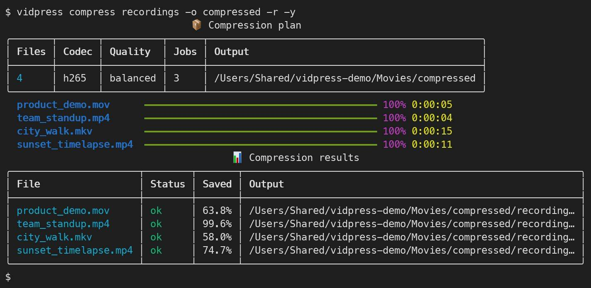
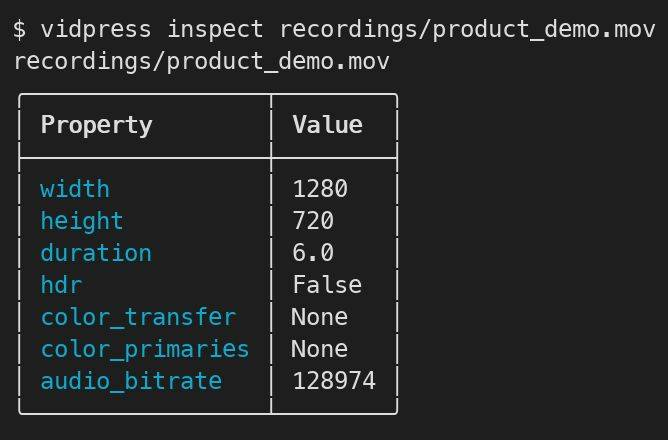
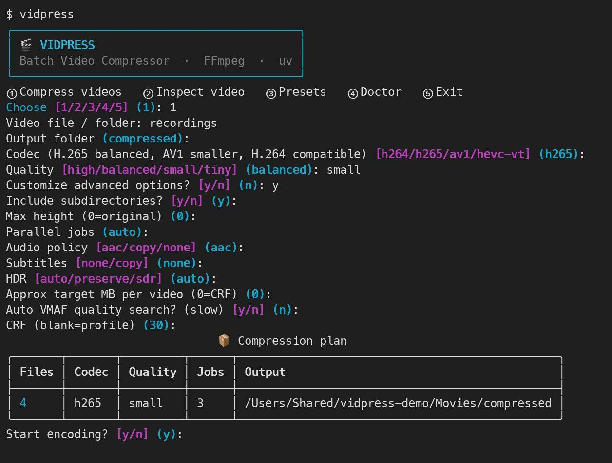
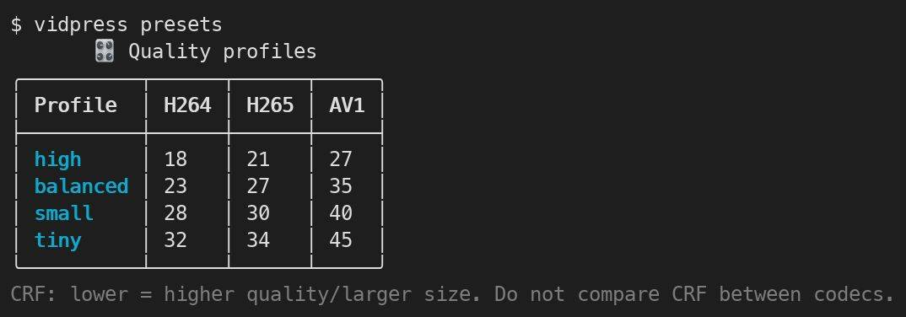

# 🎬 vidpress — macOS 免費影片批次壓縮 CLI

[English README](README.md) ｜ Python + uv + FFmpeg / FFprobe + Rich + 選用 ab-av1

**目標：用一個指令批次縮小影片容量，也可以打開彩色互動選單調整畫質、速度、解析度、HDR、平行數與壓縮報告。** 保留原始影片，不會偷偷覆寫或刪除。


## 1. 安裝（macOS）

首次安裝 Homebrew 後，在 Terminal 輸入：

```bash
brew install uv ffmpeg
cd vidpress              # 進入下載／clone 的專案資料夾
uv tool install .         # 建立隔離 Python 環境，註冊全域 vidpress 指令
vidpress                  # 開啟彩色互動介面
```

找不到 `vidpress` 指令時執行 `uv tool update-shell`，再重開 Terminal。開發環境直接用 `uv run vidpress` 也可以。

可比照 `polytool` / `monitask-center`：在 `pyproject.toml` 透過 `[project.scripts]` 定義 `vidpress = "vidpress.cli:main"`，使用 `uv tool` 安裝。內建 `Makefile`：`make install`、`make dev`、`make run`、`make test`、`make lint`、`make check`。

### 環境自動檢查／安裝

```bash
vidpress doctor
vidpress doctor --install
```

- 會確認 `uv`、`brew`、`ffmpeg`、`ffprobe`、`ab-av1` 是否存在。
- 處理影片前，也會檢查需要的 FFmpeg 編碼器。例如選 AV1 時確認 `libsvtav1`；選 H.265 時確認 `libx265`。
- 缺少 FFmpeg / FFprobe 時，可以由 Homebrew 安裝；一般互動操作先詢問，腳本使用 `--install-missing` 表示事先同意安裝。
- 只有啟用 VMAF 時才需要 `ab-av1`（及 FFmpeg 的 `libvmaf`）。工具不會擅自使用 sudo 或下載不明的安裝腳本。

## 2. 最快的使用方式





```bash
# 單一影片：預設 H.265、平衡畫質
vidpress compress ~/Movies/input.mov -o ~/Movies/compressed -y

# 整個資料夾（含子目錄），讓程式自動安排平行數
vidpress compress ~/Movies/videos -o ~/Movies/compressed -r --jobs auto -y

# 影片最小化方向：AV1、高壓縮模式（較耗時）
vidpress compress ~/Movies/videos -o ~/Movies/av1 -r -c av1 -q small --jobs 2 -y

# 容量最優先：AV1 極致壓縮
vidpress compress ~/Movies/videos -o ~/Movies/tiny -r -c av1 -q tiny -y

# macOS 支援的 HEVC 硬體加速（重視速度）
vidpress compress ~/Movies/input.mov -o ~/Movies/out -c hevc-vt -q balanced -y
```

`-y` 表示不用額外詢問就開始；不加 `-y` 在互動終端會先詢問確認。`-r` 就是 `--recursive`。輸出預設放在 `compressed/`，但建議透過 `-o` 指定其他資料夾。

## 3. 彩色互動介面與操作

直接執行：

```bash
vidpress
# 或
vidpress interactive
```

會顯示 `VIDPRESS` 彩色標題與編號選單：

1. **Compress videos**：輸入影片檔／資料夾、輸出資料夾、編碼格式、畫質。
2. **Inspect video**：查詢影片的解析度、秒數、HDR 與音訊位元率。
3. **Presets**：查看各壓縮模式的 CRF 數字。
4. **Doctor**：確認工具是否安裝。
5. **Exit**：離開。

「Customize advanced options?」選 **Yes** 可以額外調整是否遞迴、最大輸出高度、同時處理幾部影片、音訊與字幕、HDR、目標容量、VMAF（支援 H.264、H.265、AV1）、CRF。開始前會顯示整理好的批次計畫，再逐部顯示彩色進度條、時間與結果摘要。採用 Rich 繪製，不需要網頁伺服器。支援 `NO_COLOR=1`（停用顏色）。



## 4. 畫質／容量預設

| 模式 | H.264 CRF | H.265 CRF | AV1 CRF | 適合需求 |
|---|---:|---:|---:|---|
| `high` | 18 | 21 | 27 | 重視畫質與細節 |
| `balanced` | 23 | 27 | 35 | **一般預設、畫質與容量平衡** |
| `small` | 28 | 30 | 40 | 盡可能縮小 |
| `tiny` | 32 | 34 | 45 | 激進壓縮、須檢查失真 |

**CRF 越高通常容量越小、畫質越低**，但不同編碼器的 CRF 不能直接互相比較。`preset slow` 等越慢通常可提高壓縮效率，但實際差異依影片而異。



例如：

```bash
# 自訂 H.265 CRF + preset
vidpress compress input.mov -o out --codec h265 --crf 29 --preset slow -y

# 最大輸出高度 1080（不把原本小影片放大）
vidpress compress input.mov -o out --resolution 1080 -y

# 每部影片目標大約 100 MB（近似值、不保證精確大小）
vidpress compress input.mov -o out --target-size 100 -y
```

## 5. 音訊、字幕、HDR

```bash
# 直接複製原始音軌，不重新壓縮音訊
vidpress compress input.mov -o out --preserve-audio -y

# 保留音軌、字幕軌：自動產生 MKV 而非 MP4，避免字幕相容性問題
vidpress compress input.mkv -o out --preserve-audio --preserve-subtitles -y

# 不輸出音訊
vidpress compress input.mov -o out --audio none -y

# HDR 預設 auto，軟體 H.265/AV1 保留 10-bit 與主要 HDR 顏色標籤
vidpress compress hdr.mov -o out --hdr auto -c h265 -y

# 將 HDR 轉成一般 SDR：使用 FFmpeg zscale + tonemap（需支援濾鏡）
vidpress compress hdr.mov -o out --hdr sdr -c h265 -y
```

注意：不是所有輸入都帶有正確 HDR 色彩標籤，`--hdr sdr` 不保證能與原始影像的色彩完全一致。請在色彩管理播放器觀看輸出。輸入是 HDR 時，H.264 必須搭配 `--hdr sdr`，不能直接以工具宣稱完整保留 HDR。`--preserve-subtitles` 只保留字幕串流，其他附件（例如字型）不保證保留。

## 6. 用 VMAF 自動搜尋 H.264／H.265／AV1 壓縮品質

這是選用的進階模式，適合大量影片不想人工猜 CRF 的情境。

```bash
brew install ab-av1
vidpress doctor
vidpress compress input.mov -o out -c av1 --auto-vmaf 95 --jobs 1 -y
# H.265 一樣可自動搜尋品質
vidpress compress input.mov -o out -c h265 --auto-vmaf 95 --jobs 1 -y
```

流程：**ab-av1 抽樣編碼 → 計算 VMAF → 搜尋符合最低分數的 CRF → FFmpeg 正式壓縮**。ab-av1 提供結構化 JSON，CLI 解析最終 `crf-search-done` 事件取得選擇結果。VMAF 是參考指標，不等同人眼對小字、HUD、遊戲畫面都滿意；影片選樣與來源解析度也會影響結果。

限制：支援 H.264、H.265、AV1 軟體編碼（不支援 hevc-vt 硬體編碼）、不可同時指定 `--target-size`、`--resolution` 或 `--hdr sdr`。需要裝有 `libvmaf` 的 FFmpeg。可能比一般固定 CRF 編碼花費更多時間。

## 7. 批次、平行運算與安全性

```bash
# 自動判斷 CPU／同時轉檔數；預設 AV1 上限 2、其他上限 3
vidpress compress ./videos -o ./compressed --recursive --jobs auto -y

# 自己指定同時處理 4 支影片
vidpress compress ./videos -o ./compressed -r --jobs 4 -y

# 只規劃／預先檢查，不建立新影片
vidpress compress ./videos -o ./compressed -r --dry-run -y

# 輸出壓縮成果 CSV / JSON
vidpress compress ./videos -o ./compressed -r --report reports/result.csv -y
vidpress compress ./videos -o ./compressed -r --report reports/result.json -y
```

平行化不是把同一支影片任意切片，而是同時啟動多個**不同影片的 FFmpeg 程序**。每個影片仍可使用部分 CPU threads；高負載時多開不一定更快。對 SVT-AV1 或長影片，建議從 1～2 jobs 開始，比較實際總耗時與記憶體占用。

### 保護原始影片

- **不刪除、不覆寫**來源影片，輸出路徑不得等於來源。
- 不覆寫已存在的目的檔。相同輸出名稱衝突時會拒絕執行。
- 先寫入輸出資料夾中的獨立暫存檔，成功後檢查影片時長與檔案大小，才對外發布完成的檔案。
- 預設 `--skip-if-larger`：若新影片**不比來源小**，捨棄暫存結果，原始影片保留。需要強制保留輸出可改 `--no-skip-if-larger`。
- 個別影片失敗會寫入結果；批次會繼續處理其他影片；只要任一影片失敗便回傳非 0 exit code。
- `--report` 可匯出原始與輸出大小、節省百分比、編碼、狀態、錯誤訊息。

## 8. 所有常用 CLI 參數

| 參數 | 用途 |
|---|---|
| `-o / --output PATH` | 輸出資料夾 |
| `-c / --codec h264\|h265\|av1\|hevc-vt` | 選擇編碼方式 |
| `-q / --quality high\|balanced\|small\|tiny` | 選擇畫質預設 |
| `--crf N` | 指定編碼品質數值 |
| `--preset NAME` | 指定軟體編碼預設，例如 `slow`、AV1 的 `6` |
| `--jobs auto\|N` | 同時平行處理幾部影片 |
| `-r / --recursive` | 遞迴搜尋子資料夾 |
| `--resolution HEIGHT` | 最大輸出高度，較小影片不放大 |
| `--target-size MB` | 近似目標檔案大小（單次平均位元率） |
| `--audio aac\|copy\|none` | 音訊壓縮、複製或移除 |
| `--preserve-audio` | `--audio copy` 的別名 |
| `--subtitles none\|copy` | 去除或複製字幕 |
| `--preserve-subtitles` | `--subtitles copy` 的別名；輸出 MKV |
| `--hdr auto\|preserve\|sdr` | HDR 保留或 SDR tone map |
| `--auto-vmaf N` | ab-av1 自動搜尋 H.264/H.265/AV1 的 CRF，建議先測試 95 |
| `--skip-if-larger` | 預設略過更大或一樣大的結果 |
| `--no-skip-if-larger` | 即使檔案變大也保留輸出 |
| `--dry-run` | 預先檢查，不壓縮 |
| `--report PATH` | 匯出 CSV/JSON |
| `--install-missing` | 明確授權 macOS Homebrew 自動安裝缺少工具 |
| `-y / --yes` | 不再詢問是否開始 |

## 9. TDD、CI 與開發

```bash
uv sync --group dev
uv run pytest -q
uv run ruff check .
uv run vidpress --help
make check
```

專案包含測試、`.gitignore`（macOS `.DS_Store`、暫存檔、Python 快取、影片輸出、大型媒體、IDE 等）、MIT License，以及 `.github/workflows/ci.yml`；CI 預定於 macOS、Ubuntu 上執行 Ruff、Pytest 與 CLI smoke test。

> 目前建立環境無法連接 PyPI，因此無法在當前執行環境完成 `uv lock`；第一次在可連網的 Mac 執行 `uv sync` 會建立 `uv.lock`。建議提交該鎖定檔，並在 CI 將 `uv sync` 改為 `uv sync --locked`。此外，本機 Linux 測試不等於實機 macOS／GitHub CI 驗證。

## 10. 建立私人 GitHub repository

本專案是可直接 `git push` 的原始碼，以下會在**你自己已登入 GitHub CLI** 的 Mac 上建立私有 repository：

```bash
brew install gh
# gh auth login     # 若第一次使用 gh
cd vidpress
git init -b main
git add .
git commit -m "feat: initialize vidpress CLI"
gh repo create weskao/vidpress --private --source . --remote origin --push
```

若先建立本機 commit，也可以執行 `make publish-private`。**在執行並確認成功以前，`https://github.com/weskao/vidpress` 還不是已驗證有效的 GitHub 連結。**

正式建立後可以用：

```bash
# 私有 repo 需要已登入的 Git 憑證
uv tool install git+https://github.com/weskao/vidpress.git
vidpress
```

## 11. 注意事項

1. `--target-size` 是估計值而不是精準大小保證。要精確到幾 MB，未來可改成兩次編碼及迭代測試，會犧牲速度。
2. AV1 在某些舊裝置上可能無法播放；建議一般情境以 H.265 為預設。
3. H.265／AV1 的軟體編碼可能非常吃 CPU；Apple VideoToolbox 通常較快，但固定畫質下的容量不一定最好。
4. 真正的畫質必須實際觀看檢查；單靠 VMAF、CRF 或檔案大小都不能證明影片沒有失真。
5. 不會將影片上傳雲端；正常編碼由本機 FFmpeg／ab-av1 完成，路徑可能出現在輸出的報告中。
6. 本專案使用 MIT License；FFmpeg、Rich、uv、ab-av1 各自的授權仍需遵守。
